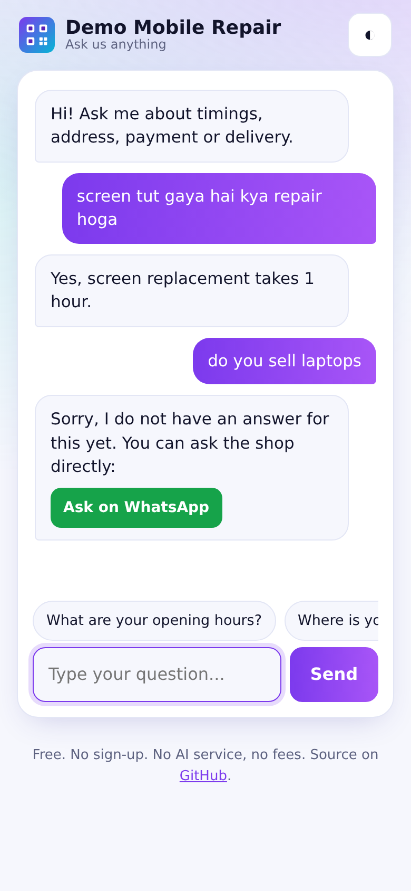
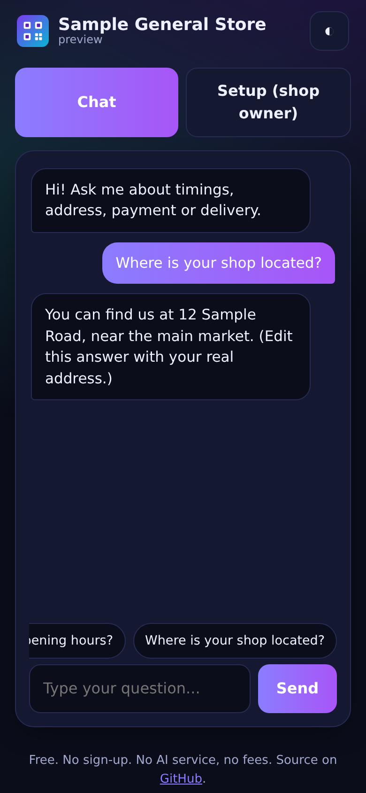
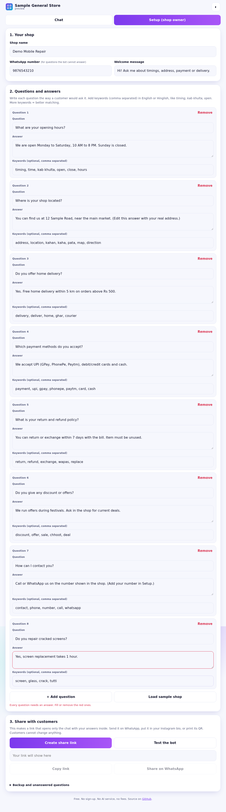

# Shop FAQ Bot

A **free FAQ chatbot for any shop**. Add your own questions and answers once, get one link, and share it on WhatsApp or Instagram. Customers chat and get instant answers. No paid AI, no sign-up, no server.

**Live app:** https://akash991833.github.io/shop-faq-bot/

| Customer chat (mobile) | Chat (dark) | Owner setup |
|---|---|---|
|  |  |  |

## How it works

1. Open the app, go to **Setup (shop owner)**.
2. Add shop name, WhatsApp number and your questions + answers. Add keywords in English or Hinglish (for example `timing, kab khulta, open`).
3. Press **Create share link**. The link opens only the chat, with your answers inside. Customers cannot edit anything.
4. If the bot cannot answer, the customer gets an **Ask on WhatsApp** button that opens your chat with their question filled in.

## Features

- Understands English, Hinglish and basic Hindi questions (spelling mistakes and word forms are handled)
- Suggests "Did you mean...?" when it is not sure
- Quick question buttons, typing animation, greeting / thanks replies
- Owner list of questions the bot could not answer on this device, so you know what to add
- Backup and restore your FAQ as a file
- Dark and light mode, works on phone and desktop, installable (PWA), works offline

## Privacy

No server. Your FAQ stays in your browser. The share link carries the FAQ inside the link itself (not stored anywhere else).

## Honest limits

- This is a **lite FAQ matcher**, not a chat AI. It only answers what you wrote. It does not understand new topics.
- On a built-in test of 37 customer-style questions (English and Hinglish) against 8 sample FAQs, all 37 were handled correctly: right answer, a "did you mean" suggestion, or a polite "I do not know". It never gave a confident wrong answer in that test. The test is small and written by the author, so real shops should try their own questions in **Test the bot**.
- Share links get long with many answers. Around 6000+ characters some apps may cut the link; the app warns you.
- The "could not answer" list is saved on the owner's device only. It does not collect questions from customers' phones.

## Run it yourself

```bash
python3 -m http.server 8000      # open http://localhost:8000
node tests/match-test.js         # matching checks
```

Plain HTML, CSS and JavaScript. Hosted free on GitHub Pages.

## License

MIT
